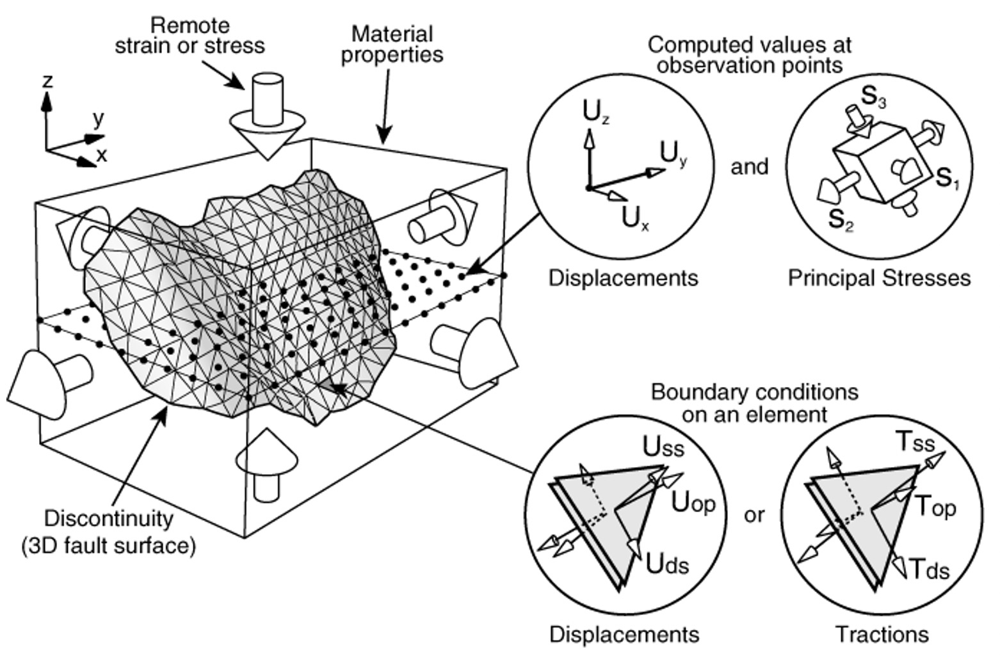
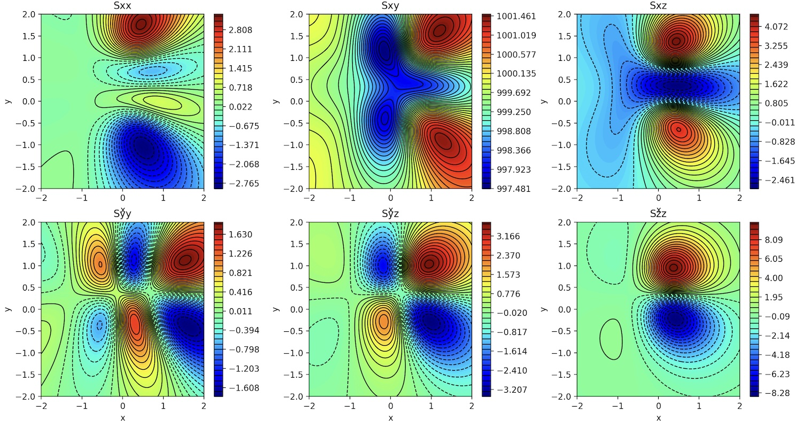

<h1 align="center">Arch&nbsp;×&nbsp;Rosetta</h1>

<p align="center">
  <em>Automatic, multi-language bindings for the Arch library(private), a 3D BEM code — generated, not hand-written</em>
</p>




<p align="center">
  <a href="https://github.com/xaliphostes/arch3"></a>
  <a href="https://github.com/xaliphostes/rosetta"></a>

  
  

  
</p>

---

This project points [**Rosetta**](https://github.com/xaliphostes/rosetta) at the [**Arch Library** ](https://github.com/xaliphostes/arch3.git) (successor **Poly3D** and **iBem3D**) and, from a single [`manifest.json`](manifest.json), generates ready-to-build bindings **without touching a line of Arch's source**.

> Arch is a private repos. So this project is provided for information (all the bindings are working of cource).
> 
> __More info about the technology__:
> [Maerten, F., Maerten, L., & Pollard, D. D. (2014). iBem3D, a three-dimensional iterative boundary element method using angular dislocations for modeling geologic structures. Computers and Geosciences, 72, 1-17]((https://www.sciencedirect.com/science/article/abs/pii/S0098300414001496#:~:text=Review-,iBem3D%2C%20a%20three-dimensional%20iterative%20boundary%20element%20method%20using%20angular,dislocations%20for%20modeling%20geologic%20structures))

## Build

One-time bootstrap: fetch `rosetta` into `extern/` and build `rosetta_gen`:

```bash
cmake -B build && cmake --build build
```

Then, generate the `generator` + all the bindings and compile all of them:

```bash
./extern/rosetta/bin/rosetta_gen --build manifest.json
```

### Run the examples

Each backend has a ready-to-run demo in `examples/`. Build the matching
binding above first, then run from anywhere (the scripts locate the binding
relative to themselves):

#### 1. Python

```sh
python3 examples/example_python.py
```

#### 2. Node (native N-API addon)

```sh
node examples/example_node.js
```

#### 3. WebAssembly with Node

```sh
node examples/example_wasm.js
```

#### 4. Hector Mine slip inversion (python)

A real case: the 1999 Mw 7.1 Hector Mine InSAR slip inversion, replicating the
historical Poly3Dinv run of `examples/HectorMine/hector3.txt`.

```sh
python3 examples/HectorMine/main.py
```

#### 5. Tabular (layered) medium (python)

Solves the same forward model twice — homogeneous half-space, then with an
`arch.TabularMedium` attached — and compares the fault slip, plus displacement
and strain on a vertical cross-section and on the free surface.

```sh
python3 examples/tabular/main.py
```

It currently reports **no difference on any field**: `TabularMedium::correction`
is applied only in `DisplCoefficients::influence`, which the forward path never
calls (the solver assembles through `StrainCoefficients`, and `Postprocess`
displacement goes through `DisplCoefficients::value`). Only influence-matrix
consumers — the slip inversion — inherit the layering today. The script is the
regression test for wiring the correction into the forward path.
